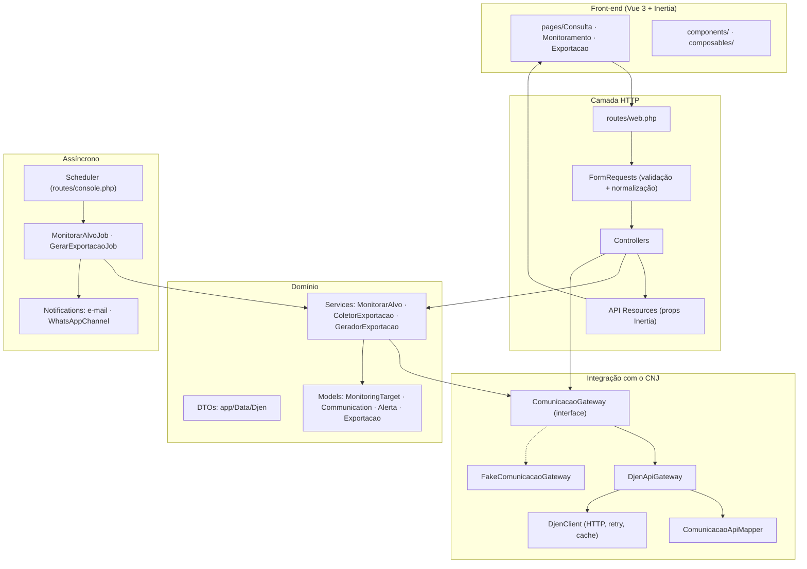
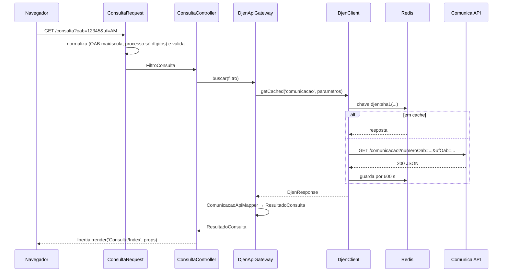

# 02 · Arquitetura

## Visão em camadas



### Regras que mantêm essa estrutura

1. **Só o `DjenClient` faz HTTP para o CNJ.** Nada de `Http::` espalhado.
2. **Só o `ComunicacaoApiMapper` conhece os nomes de campos da API.** Do mapper para
   cima, tudo é DTO do app (`ComunicacaoData`, `ResultadoConsulta`...).
3. **Controllers e services dependem da interface `ComunicacaoGateway`**, não da
   implementação. Isso permite trocar para o gateway `fake` (desenvolvimento fora do
   Brasil) e para gateways em memória nos testes.
4. **Props do Inertia saem de API Resources**, espelhados em tipos TypeScript em
   `resources/js/types/`. Mudou um Resource? Mude o tipo.
5. **Validação e normalização ficam nos FormRequests** (`ConsultaRequest`,
   `StoreMonitoringTargetRequest`...). O controller recebe dados já limpos.

## Mapa de pastas

```
app/
├── Console/Commands/        djen:monitorar, djen:diagnostico, djen:verificar-filtros, djen:capturar-fixture
├── Data/Djen/               DTOs imutáveis (readonly): ComunicacaoData, FiltroConsulta, ResultadoConsulta...
├── Enums/                   TipoAlvo, FormatoExportacao, OrigemExportacao, StatusExportacao
├── Http/
│   ├── Controllers/         ConsultaController, ExportacaoController, Monitoramento/*
│   ├── Requests/            validação + normalização de entrada
│   └── Resources/           formato das props enviadas ao Vue
├── Jobs/                    MonitorarAlvoJob, GerarExportacaoJob
├── Models/                  MonitoringTarget, Communication, Alerta (pivot), Exportacao, User
├── Notifications/           NovasComunicacoes, ExportacaoConcluida, Channels/WhatsAppChannel, WhatsApp/*
├── Policies/                posse de alvos, alertas e exportações
├── Providers/               AppServiceProvider: bindings do gateway, WhatsApp e rate limiters
├── Services/
│   ├── Djen/                DjenClient, DjenResponse, Contracts/, Gateways/, Mapping/, Exceptions/
│   ├── Exportacao/          ColetorExportacao, GeradorExportacao, PlanilhaComunicacoes, LinhaExportacao
│   └── Monitoramento/       MonitorarAlvo
└── Support/                 Oab (regex + normalização), HtmlSanitizer
config/
├── djen.php                 tudo que é configurável do domínio (ver 10 · Operação)
└── tribunais.php            lista estática de tribunais (sigla → nome)
resources/js/
├── pages/                   uma pasta por aba + Erro.vue (+ telas do kit: auth/, settings/)
├── components/              FiltroBusca, CardComunicacao, PainelComunicacao, Paginacao, ...
├── composables/             useSelecao, useExportar (+ os do kit)
├── layouts/                 PublicLayout (Consulta, Erro) e AppLayout (área logada)
├── lib/cnj.ts               máscara CNJ, normalização de OAB
└── types/                   espelho dos API Resources
tests/
├── Feature/ · Unit/         Pest (PostgreSQL)
├── Fixtures/djen/           resposta real da API, anonimizada
└── Support/                 GatewayEmMemoria e afins
deploy/                      nginx, supervisor, cron, deploy.sh, env de produção
```

## Ciclo de uma requisição (Consulta)



## Decisões de arquitetura (e por quê)

| Decisão                                        | Motivo                                                                                                       |
| ---------------------------------------------- | ------------------------------------------------------------------------------------------------------------ |
| Backend chama o CNJ, nunca o navegador         | Decisão de produto: controle de cache, rate limit, erros e independência de CORS. Exige servidor no Brasil.  |
| Vue Starter Kit oficial (não Breeze)           | Breeze foi descontinuado no Laravel 12. O kit traz Fortify, 2FA e passkeys.                                  |
| Ziggy **e** Wayfinder                          | Wayfinder é exigido pelas telas do kit; Ziggy (`route('nome')`) foi o pedido para as telas do domínio.       |
| PostgreSQL em todo lugar (dev, testes, CI)     | Mesmo banco em todos os ambientes; uso de `jsonb`. Evita surpresas de SQLite.                                |
| Deduplicação por índice único, não por código  | `communications.hash` e `(communication_id, monitoring_target_id)` únicos tornam a dedup à prova de corrida. |
| DTOs `readonly` em vez de arrays               | Tipagem e contrato claro entre a API e o resto do app.                                                       |
| Gateway `fake`                                 | Desenvolver e demonstrar fora do Brasil, sem a API.                                                          |
| WhatsApp atrás de interface (`WhatsAppDriver`) | Trocar de provedor (Evolution, Z-API, Meta) sem mexer na notificação.                                        |
| HTML do inteiro teor sanitizado no servidor    | O texto vem do CNJ e é exibido com `v-html`; allowlist sem atributos elimina XSS.                            |
| Fonte local (`@fontsource`)                    | Build sem dependência de CDN externa.                                                                        |
| Larastan removido                              | Dependia de download bloqueado no ambiente de desenvolvimento em nuvem. Pode voltar.                         |
