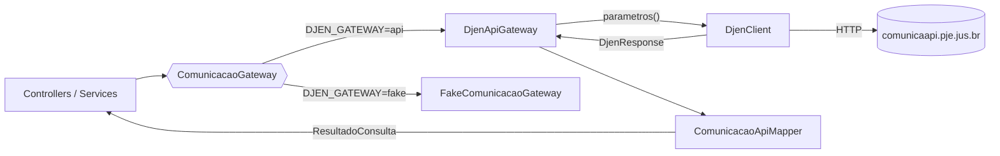

# 03 · Integração com o DJEN (Comunica API)

Tudo que fala com o CNJ fica em `app/Services/Djen/`.



## A API

| Item           | Valor                                                                      |
| -------------- | -------------------------------------------------------------------------- |
| Produção       | `https://comunicaapi.pje.jus.br/api/v1` (`DJEN_BASE_URL`)                  |
| Homologação    | `https://hcomunicaapi.cnj.jus.br/api/v1`                                   |
| Endpoint usado | `GET /comunicacao`                                                         |
| Autenticação   | Nenhuma                                                                    |
| Restrição      | **Bloqueio geográfico**: IP fora do Brasil recebe `403` (CloudFront)       |
| Rate limit     | Cabeçalhos `x-ratelimit-limit: 20` e `x-ratelimit-remaining`               |
| Cache HTTP     | `cache-control: max-age=120`                                               |
| CORS           | `access-control-allow-origin: *` (não usamos: o navegador não chama a API) |

### Formato da resposta (confirmado em chamada real)

```json
{
    "status": "success",
    "message": "Sucesso",
    "count": 10000,
    "items": [{ "...": "um objeto por comunicação" }]
}
```

`count` é o total de resultados, **limitado a 10000** pela API.

Campos de cada item, e o que fazemos com eles:

| Campo da API              | Exemplo / formato                                 | Uso no app (`ComunicacaoData`)                          |
| ------------------------- | ------------------------------------------------- | ------------------------------------------------------- |
| `hash`                    | string única                                      | `hash` (deduplicação). Item sem hash é ignorado.        |
| `siglaTribunal`           | `TJMG`, `TRT3`                                    | `tribunal`                                              |
| `nomeOrgao`               | "1ª Vara Cível..."                                | `orgaoJulgador`                                         |
| `tipoComunicacao`         | "Intimação"                                       | `tipoComunicacao`                                       |
| `tipoDocumento`           | "Despacho"                                        | `tipoDocumento`                                         |
| `data_disponibilizacao`   | `2026-11-05` (Y-m-d)                              | `dataDisponibilizacao`                                  |
| `numero_processo`         | 20 dígitos                                        | `numeroProcesso` (fallback: `numeroprocessocommascara`) |
| `texto`                   | texto puro **ou** HTML                            | `textoHtml` (ver abaixo)                                |
| `link`                    | URL ou `null`                                     | `linkDocumento` (só http/https na tela)                 |
| `destinatarios[]`         | `{comunicacao_id, nome, polo}`                    | `destinatarios` (só `nome`, sem repetição)              |
| `destinatarioadvogados[]` | `{..., advogado: {id, nome, numero_oab, uf_oab}}` | `advogados` (sem repetição por `advogado.id`)           |

Outros campos existem na resposta (`id`, `idOrgao`, `meio`, `meiocompleto`, `nomeClasse`,
`codigoClasse`, `numeroComunicacao`, `ativo`, `status`, `motivo_cancelamento`,
`data_cancelamento`, `datadisponibilizacao` em d/m/Y, `numeroprocessocommascara`), mas não
são usados hoje. A referência completa é a fixture `tests/Fixtures/djen/comunicacao.json`.

### Pegadinhas da resposta (tratadas no mapper)

- **`texto` em dois formatos.** Às vezes é texto puro com `\n` e entidades (`&nbsp;`,
  `&Aacute;`); às vezes é HTML (fragmento, ou documento inteiro com `<!DOCTYPE>`,
  `<?xml?>` e `<style>`). O mapper detecta HTML por uma tag de verdade (`<` colado a um
  nome de tag), para não confundir `x < y` com HTML. Texto puro é decodificado,
  escapado e recebe `<br>` nas quebras.
- **Repetições.** O mesmo destinatário e o mesmo advogado aparecem mais de uma vez na
  mesma comunicação.
- **OAB alfanumérica.** `numero_oab` pode ser `11811N` ou `20413-O`. Por isso
  `App\Support\Oab::REGEX` é `^\d{1,8}(-?[A-Z])?$`.
- **Advogado placeholder.** "SISTEMA DE CITAÇÃO E INTIMAÇÃO ELETRÔNICA", OAB `99999999`.
- **`nomeClasse` com caixa quebrada.** Não exibimos.

## Parâmetros de filtro

`DjenApiGateway::parametros()` traduz o `FiltroConsulta` do app para a query da API:

| Filtro do app (URL) | `FiltroConsulta`    | Parâmetro enviado à API         | Confirmado?           |
| ------------------- | ------------------- | ------------------------------- | --------------------- |
| `oab`               | `numeroOab`         | `numeroOab`                     | indício forte¹        |
| `uf`                | `ufOab`             | `ufOab`                         | indício forte¹        |
| `parte`             | `nomeParte`         | `nomeParte`                     | **sim**               |
| `advogado`          | `nomeAdvogado`      | `nomeAdvogado`                  | a verificar           |
| `processo`          | `numeroProcesso`    | `numeroProcesso`                | a verificar           |
| `tribunal`          | `tribunal`          | `siglaTribunal`                 | **sim**               |
| `texto`             | `texto`             | `texto` (palavra-chave no teor) | **sim**               |
| `inicio`            | `dataInicio`        | `dataDisponibilizacaoInicio`    | **sim**               |
| `fim`               | `dataFim`           | `dataDisponibilizacaoFim`       | **sim**               |
| `meio`              | `meio`              | `meio` (`D` ou `E`)             | a verificar           |
| `comunicacao`       | `numeroComunicacao` | `numeroComunicacao`             | a verificar           |
| `tipo`              | `tipoComunicacao`   | — (filtrado no nosso servidor²) | **ignorado pela API** |
| `pagina`            | `pagina`            | `pagina`                        | a verificar           |
| —                   | `porPagina`         | `itensPorPagina`                | **sim**               |

"**sim**" = visto num request real a `GET /comunicacao` (10/11/2026):
`siglaTribunal=TJAM&nomeParte=bradesco&texto=alienação fiduciária&dataDisponibilizacaoInicio=2026-11-04&dataDisponibilizacaoFim=2026-11-10&itensPorPagina=100`.
Os valores de `meio` (`D` = Diário de Justiça Eletrônico Nacional, `E` = Plataforma Nacional
de Editais) vêm da resposta real; o **nome do parâmetro** `meio`, assim como
`numeroComunicacao`, ainda precisa ser conferido (`--meio`, `--comunicacao`). Os tipos aceitos
pelo app estão em `ConsultaRequest::TIPOS`.

¹ Em produção (10/11/2026), `numeroOab=5055&ufOab=AM` devolveu `count` 1001, e não o teto
de 10000 de uma consulta sem filtro: o filtro por OAB é aplicado.

² Em produção (10/11/2026), `tipoComunicacao=Edital` (ou qualquer outro tipo) devolvia o mesmo
`count` 1001 da busca sem tipo: a API ignora o parâmetro. Por isso `DjenApiGateway::buscarPorTipo()`
busca as páginas da API (`DJEN_FILTRO_TIPO_ITENS_POR_PAGINA`, 100), no máximo
`DJEN_FILTRO_TIPO_MAX_PAGINAS` (10), cada uma no cache, guarda as do tipo pedido e pagina aqui. Se
a API tiver mais comunicações que isso, o resultado vem com `meta.filtroParcial
{analisadas, totalApi}` e a tela avisa para reduzir o período. `djen:verificar-filtros --tipo`
continua disponível para conferir se algum dia a API passar a filtrar.

> [!NOTE]
> A certidão da comunicação (PDF) não está implementada: o endereço dela na API ainda não
> foi visto num request real. Capture-o no navegador (aba Network) para implementarmos.

> [!IMPORTANT]
> Uma API que não reconhece um parâmetro costuma **ignorá-lo** e devolver
> comunicações quaisquer, sem erro. Por isso existe `php artisan djen:verificar-filtros`:
> ele faz chamadas reais pequenas e confere, item por item, se o resultado respeita
> o filtro (ex.: todos os itens são do `TJSP`; nenhum item da página 2 repete a 1).
> Resultado por filtro: **OK**, **FALHOU** (parâmetro ignorado: corrija o nome em
> `parametros()`) ou **SEM DADOS** (tente outro valor). Precisa rodar no Brasil.

```bash
php artisan djen:verificar-filtros --oab=12345 --uf=AM --processo=00012345620248040001 --parte="FULANO" --advogado="CICLANO" --texto="penhora" --meio=E --comunicacao=1 --tipo=Edital
```

## DjenClient

`App\Services\Djen\DjenClient` é o **único** lugar que faz HTTP para o CNJ.

- `get($path, $query)` → `DjenResponse` (status, json, headers).
- `getCached($path, $query)` → mesmo, com cache de `DJEN_CACHE_TTL` segundos (600).
  Só respostas de sucesso entram no cache. A chave é `djen:` + sha1 da query
  normalizada e ordenada, ou seja, a ordem dos parâmetros não importa.
- **Normalização**: remove `null` e `''`, apara espaços.
- **Timeouts**: `DJEN_TIMEOUT` (20 s) e `DJEN_CONNECT_TIMEOUT` (5 s).
- **Retry**: até `DJEN_RETRY_TIMES` (3) tentativas extras em falha de conexão, `429` e
  `5xx`. Espera exponencial `sleep_ms × 2^(n-1)` (500 ms, 1 s, 2 s...) limitada por
  `max_sleep_ms` (10 s). Em `429` usa o `Retry-After`, também limitado. Erros `4xx`
  não são retentados.

### Exceções

Todas herdam de `DjenException`, então quem chama pode capturar uma só.

| Exceção                           | Quando                               | Como o app reage                                            |
| --------------------------------- | ------------------------------------ | ----------------------------------------------------------- |
| `DjenUnavailableException`        | timeout, falha de rede, `5xx`        | Consulta: aviso "fora do ar". Job: retry com backoff.       |
| `DjenRateLimitedException`        | `429` (tem `retryAfterSeconds`)      | Consulta: "aguarde um minuto". Job: `release(Retry-After)`. |
| `DjenBlockedException`            | `403` (geobloqueio)                  | Consulta: "o CNJ recusou o acesso". Job: `fail()`.          |
| `DjenBadRequestException`         | outros `4xx`                         | Job: `fail()`.                                              |
| `DjenUnexpectedResponseException` | `2xx` que não é JSON, ou sem `items` | Consulta: erro genérico.                                    |

### Rate limits do nosso lado

Definidos em `AppServiceProvider::configureRateLimiting()`:

- `djen` — global, `DJEN_RATE_LIMIT_PER_MINUTE` (15/min). Usado pelos jobs via
  middleware `RateLimited('djen')`, para não estourar o limite do CNJ.
- `djen-consulta` — por IP, `DJEN_PUBLIC_RATE_LIMIT_PER_MINUTE` (30/min), na rota
  `/consulta`.

## Gateways

| Gateway                          | `DJEN_GATEWAY` | Para quê                                                                |
| -------------------------------- | -------------- | ----------------------------------------------------------------------- |
| `DjenApiGateway`                 | `api` (padrão) | Produção: chama o CNJ.                                                  |
| `FakeComunicacaoGateway`         | `fake`         | 45 comunicações fictícias, filtráveis. Para desenvolver fora do Brasil. |
| `Tests\Support\GatewayEmMemoria` | (testes)       | Simula comunicações que aparecem entre execuções do monitoramento.      |

A lista de tribunais (`tribunais()`) vem de `config/tribunais.php`: não há endpoint
confirmado na API para isso. As siglas seguem o formato de `siglaTribunal`.

## Ferramentas de linha de comando

| Comando                        | O que faz                                                                                                |
| ------------------------------ | -------------------------------------------------------------------------------------------------------- |
| `djen:diagnostico [--sem-api]` | Confere banco, cache, fila, e-mail, gateway e se **este servidor** alcança a API (403 = fora do Brasil). |
| `djen:verificar-filtros`       | Confere na API real se cada parâmetro de filtro filtra de fato.                                          |
| `djen:capturar-fixture`        | Faz uma chamada real e salva a resposta (e os cabeçalhos) como fixture de teste.                         |

> [!WARNING]
> `djen:capturar-fixture` salva **dados pessoais reais**. Anonimize nomes e documentos
> antes de commitar, mantendo chaves e tipos (ver `tests/Fixtures/djen/README.md`).

## Como adaptar se a API mudar

1. Capture uma resposta nova: `php artisan djen:capturar-fixture --param=...`.
2. Anonimize e substitua `tests/Fixtures/djen/comunicacao.json`.
3. Ajuste `ComunicacaoApiMapper` (campos) ou `DjenApiGateway::parametros()` (filtros).
4. Rode `php artisan test --filter=Djen` e, no servidor, `djen:verificar-filtros`.
5. Atualize este documento e o `CLAUDE.md`.
