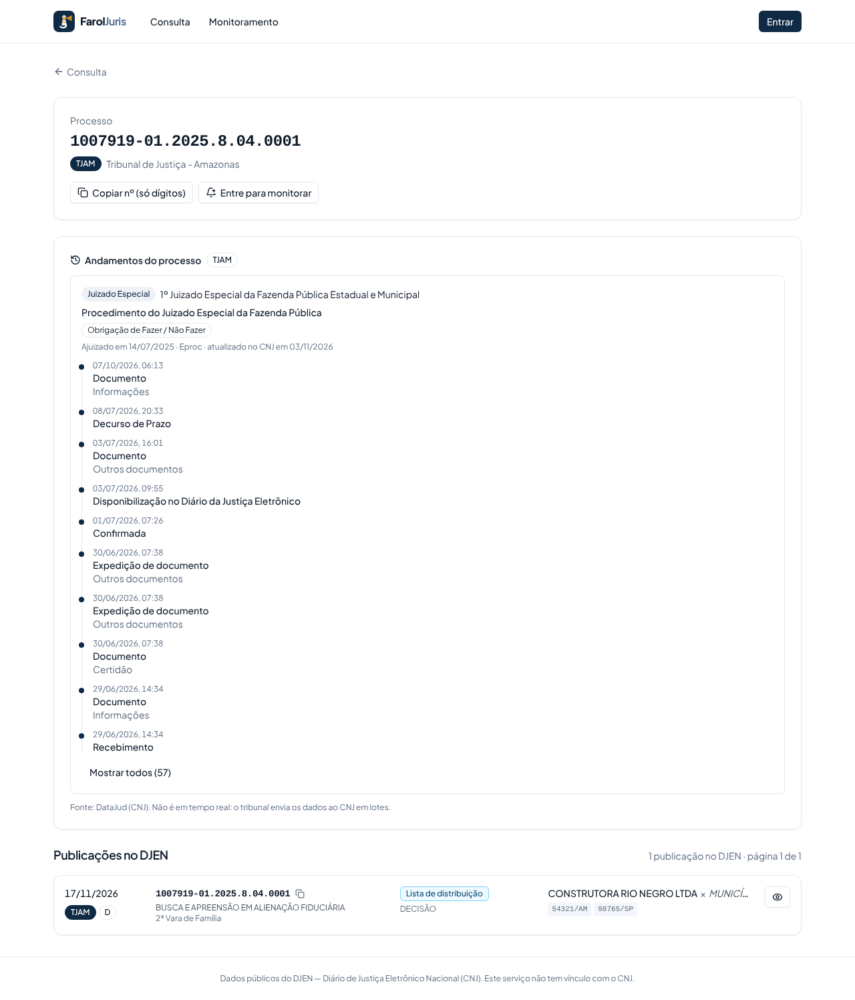

# 04 · Aba Consulta

Busca pública (sem login) nas comunicações do DJEN.

| Item       | Onde                                                                         |
| ---------- | ---------------------------------------------------------------------------- |
| Rota       | `GET /consulta` → `consulta.index` (`/` redireciona para cá)                 |
| Middleware | `throttle:djen-consulta` (30/min por IP)                                     |
| Validação  | `App\Http\Requests\ConsultaRequest`                                          |
| Controller | `App\Http\Controllers\ConsultaController`                                    |
| Resposta   | `ResultadoConsultaResource` → página `resources/js/pages/Consulta/Index.vue` |

## Filtros (query string)

A URL é a fonte da verdade: qualquer busca pode ser compartilhada por link.

| Parâmetro     | Regra                                                               | Normalização                                      |
| ------------- | ------------------------------------------------------------------- | ------------------------------------------------- |
| `oab`         | `^\d{1,8}(-?[A-Z])?$`, exige `uf`                                   | maiúsculas; remove "OAB", espaços, pontos, barras |
| `uf`          | uma das 27 UFs, exige `oab`                                         | maiúsculas                                        |
| `parte`       | 3 a 120 caracteres                                                  | apara espaços                                     |
| `advogado`    | 3 a 120 caracteres                                                  | apara espaços                                     |
| `processo`    | exatamente 20 dígitos                                               | remove tudo que não é dígito (aceita a máscara)   |
| `tribunal`    | `[A-Z0-9]+`, até 20                                                 | maiúsculas                                        |
| `inicio`      | `AAAA-MM-DD`                                                        | —                                                 |
| `fim`         | `AAAA-MM-DD`, `>= inicio`                                           | —                                                 |
| `texto`       | 3 a 200 caracteres (palavra-chave no teor)                          | apara espaços                                     |
| `meio`        | `D` ou `E` (`ConsultaRequest::MEIOS`)                               | maiúsculas                                        |
| `comunicacao` | 1 a 12 dígitos (nº da comunicação)                                  | só dígitos                                        |
| `tipo`        | um de `ConsultaRequest::TIPOS` (filtrado no servidor: a API ignora) | —                                                 |
| `pagina`      | 1 a 500                                                             | —                                                 |

**Só busca se houver critério**: OAB, parte, advogado, processo, tribunal ou palavra-chave. Datas e
página sozinhas não disparam consulta (`FiltroConsulta::temCriterio()`).

### Erro de validação não redireciona

Num GET compartilhável, redirecionar de volta com erros criaria um loop. Por isso
`ConsultaRequest::failedValidation()` só marca a requisição como inválida: a página é
renderizada com a prop `errors`, os filtros digitados continuam no formulário e **a API
não é chamada**.

## Props da página

```ts
// resources/js/types/djen.ts → ConsultaPageProps
{
  filtros: FiltrosConsulta;            // o que veio na URL, para preencher o formulário
  resultados: ResultadoConsulta | null; // null = não buscou (sem critério ou inválido)
  erro: ErroConsulta | null;           // falha ao falar com o CNJ
  tribunais: Tribunal[];               // config/tribunais.php (prop lazy)
  ufs: string[];
}
```

`ResultadoConsulta` = `{ data: Comunicacao[], meta: { pagina, porPagina, total, ultimaPagina } }`.

### Erros do CNJ

`ConsultaController::erro()` converte a exceção em `{tipo, mensagem}`, e o erro é
registrado em log (`report`):

| `tipo`         | Causa                           | Mensagem para o usuário (resumo)                |
| -------------- | ------------------------------- | ----------------------------------------------- |
| `limite`       | `429` do CNJ                    | Muitas consultas, aguarde um minuto.            |
| `bloqueado`    | `403` (servidor fora do Brasil) | O CNJ recusou o acesso a partir deste servidor. |
| `indisponivel` | timeout, rede, `5xx`            | O serviço do CNJ está fora do ar ou lento.      |
| `inesperado`   | qualquer outra `DjenException`  | Não foi possível concluir a consulta.           |

O nosso próprio rate limit (`throttle:djen-consulta`) devolve a página de erro 429, com
o tempo de espera (`Retry-After`).

## Comportamento da tela

- **Formulário** (`components/FiltroBusca.vue`):
    - **Só busca ao enviar** (botão **Buscar** ou Enter). Digitar, trocar select (UF,
      tribunal, tipo, meio), data ou atalho de período só muda o formulário: buscar a cada
      tecla atrapalhava quem ainda estava digitando.
    - Enquanto o formulário difere dos filtros da URL, aparece "Filtros alterados. Clique em
      Buscar para atualizar os resultados." (espaços a mais não contam).
    - **Limpar** zera os campos e volta ao estado inicial (sem critério, não chama o CNJ).
    - O número do processo ganha a máscara CNJ enquanto se digita (`lib/cnj.ts`).
- **Navegação**: `router.get(..., { preserveState, preserveScroll })`, mantendo os
  filtros na URL.
- **Resultados**: lista compacta (`LinhaComunicacao`), uma linha por comunicação, com as
  colunas Disponib. (data, tribunal e meio D/E), Processo/órgão (número com botão de copiar
  só os dígitos, classe e órgão), Tipo (selo colorido por tipo, `TipoComunicacaoBadge`, e
  o tipo de documento), Partes e advogados ("ATIVO × passivo" e até 3 OABs, com "+N") e
  Ações (ver detalhes). No celular, as colunas empilham. Depois, `Paginacao`.
  Cores dos tipos em `lib/comunicacao.ts` (Intimação âmbar, Citação rosa, Edital violeta,
  Lista de distribuição azul, Pauta de julgamento verde; outros neutros). O nome do tipo
  vai sempre escrito: a cor só ajuda a bater o olho.
- **Atalhos de período** (`lib/datas.ts`): Hoje, Ontem, 7 dias, 30 dias, Este mês, Mês
  passado e Sem datas preenchem as datas (no fuso do navegador) e buscam na hora.
- **Filtros avançados** (recolhidos; abrem sozinhos se vierem na URL): meio de publicação
  e nº da comunicação.
- **Painel lateral** (`PainelComunicacao`, abre ao clicar no número do processo ou em
  "Ver detalhes"; também no Monitoramento): nº da comunicação na API, tribunal, órgão,
  tipo, meio, classe (com código), tipo de documento, ID/hash, destinatários com o polo
  (Ativo/Passivo; outros códigos aparecem como "Polo X"), advogados com OAB, link do
  documento, botões **Copiar nº (só dígitos)** e **Todas deste processo** (nova consulta
  pelo número) e o teor em três visões: **Formatado**, **Texto** e **Dados** (JSON), com
  **Copiar**. O `textoHtml` já chega **sanitizado** pelo `App\Support\HtmlSanitizer`:
    - allowlist de tags de texto e tabela (`p`, `br`, `strong`, `table`, `td`...),
      **sem nenhum atributo**;
    - `script`, `style`, `iframe`, `svg`, `form` etc. são removidos com o conteúdo.
    - `linkDocumento` só é exibido se for `http(s)`.
- **Estados**: skeleton durante o carregamento (`consulta/SkeletonResultados`),
  `EstadoVazio` sem resultados e alerta com a mensagem de `erro`.
- **Seleção para exportar**: cada card tem checkbox; a `BarraExportacao` aparece com a
  contagem. Visitante vê um convite para entrar. Ver [06 · Exportação](06-exportacao.md).

## Cache

A mesma busca (mesmos filtros, em qualquer ordem) dentro de 10 minutos vem do cache do
`DjenClient`, sem nova chamada ao CNJ. A exportação aproveita isso ao rebuscar as
páginas selecionadas.

## Testes

- `tests/Feature/Consulta/` — validação, normalização, erros do CNJ, `assertInertia`.
- `resources/js/components/FiltroBusca.test.ts`, `CardComunicacao.test.ts`,
  `Paginacao.test.ts` e `resources/js/lib/cnj.test.ts`.

## Página do processo

`GET /processos/{numero}` (`processos.show`, pública, `throttle:djen-consulta`), aberta pelo botão
**Página do processo** do painel lateral. Junta num endereço próprio:

- o número com máscara e o tribunal, deduzido do número (`App\Support\NumeroCnj::tribunal()`: J = 8 →
  TJ pela tabela de TR; J = 4 → TRF; J = 5 → TRT; superiores e demais segmentos ficam sem tribunal);
- os **andamentos** do DataJud, nos tribunais habilitados (ver [14](14-andamentos-datajud.md));
- as **publicações no DJEN** (`FiltroConsulta(numeroProcesso)`, paginadas com `?pagina=`), com o mesmo
  painel lateral da Consulta;
- **Monitorar este processo** (cria o alvo `processo` do usuário logado; visitante vê "Entre para
  monitorar"; quem já monitora vê "Monitorado").

O número com máscara (`/processos/0293096-02.2026.8.04.1000`) redireciona (301) para o endereço só com
dígitos; número sem 20 dígitos dá 404. A busca entra no rastreio com a origem `processo`. A página tem
`noindex`: ela mostra nomes de partes vindos do DJEN, e indexá-los em buscadores pede uma decisão de LGPD.


