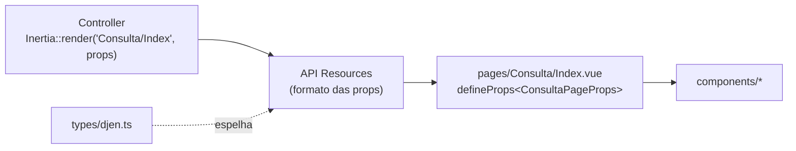

# 08 · Front-end

Vue 3 (`<script setup lang="ts">`) + Inertia 3 + TypeScript + Tailwind 4 + componentes
shadcn-vue (`resources/js/components/ui/`). Não há API REST para o front: cada página
recebe suas **props** do controller via Inertia.

## Como uma página nasce



1. O controller chama `Inertia::render('Pasta/Pagina', [...])`.
2. As props passam por API Resources (`app/Http/Resources/`).
3. A página em `resources/js/pages/Pasta/Pagina.vue` declara as props com os tipos de
   `resources/js/types/`. **Os tipos espelham os Resources**: mudou um, mude o outro.

## Layouts

Definidos em `resources/js/app.ts`, pelo nome da página:

| Página                                 | Layout                                                                      |
| -------------------------------------- | --------------------------------------------------------------------------- |
| `Consulta/*`, `Erro`                   | `PublicLayout` (topo com marca, Consulta/Monitoramento, Entrar/Criar conta) |
| `auth/*`                               | `AuthLayout`                                                                |
| `settings/*`                           | `AppLayout` + `SettingsLayout`                                              |
| demais (`Monitoramento`, `Exportacao`) | `AppLayout` (barra lateral)                                                 |

## Rotas no front

- Telas do domínio: **Ziggy**, `route('consulta.index')`, `route().current('consulta.*')`.
- Telas do kit (auth, settings): **Wayfinder** (funções geradas em `resources/js/actions`
  e `resources/js/routes`, que não devem ser editadas à mão).

## Páginas e componentes do domínio

| Arquivo                                                | Papel                                                                                       |
| ------------------------------------------------------ | ------------------------------------------------------------------------------------------- |
| `pages/Consulta/Index.vue`                             | Busca pública: filtros, resultados, paginação, seleção, modal                               |
| `pages/Monitoramento/Index.vue`                        | Painel: alvos, alertas (filtro por alvo/status), preferências, LGPD                         |
| `pages/Exportacao/Index.vue`                           | Lista de exportações, polling enquanto há alguma em andamento                               |
| `pages/Erro.vue`                                       | Página de erro 403/404/429/500/503 (renderizada por `bootstrap/app.php`)                    |
| `components/FiltroBusca.vue`                           | Formulário da Consulta, com debounce de 700 ms e máscara CNJ                                |
| `components/CardComunicacao.vue`                       | Um resultado; com `selecionavel` + `v-model:selecionada`                                    |
| `components/LinhaComunicacao.vue`                      | Uma comunicação em linha compacta (lista da Consulta)                                       |
| `components/TipoComunicacaoBadge.vue`                  | Selo colorido do tipo de comunicação (cores em `lib/comunicacao.ts`)                        |
| `components/PainelComunicacao.vue`                     | Painel lateral (Sheet) com todos os dados da comunicação e o teor (formatado, texto, dados) |
| `components/Paginacao.vue`                             | Navegação entre páginas                                                                     |
| `components/EstadoVazio.vue`                           | "Nenhum resultado" e afins                                                                  |
| `components/BarraExportacao.vue`                       | Contagem selecionada, formato e botão de exportar                                           |
| `components/consulta/SkeletonResultados.vue`           | Esqueleto durante o carregamento                                                            |
| `components/monitoramento/FormAlvo.vue`                | Cadastro de alvo (OAB+UF, parte, processo)                                                  |
| `components/monitoramento/ListaAlvos.vue`              | Alvos com contagens, pausar, verificar agora, excluir                                       |
| `components/monitoramento/PreferenciasNotificacao.vue` | E-mail, WhatsApp e "excluir todos os meus dados"                                            |
| `composables/useSelecao.ts`                            | Seleção que sobrevive à paginação (chave → página)                                          |
| `composables/useExportar.ts`                           | `POST /exportacoes` + toast de erro                                                         |
| `lib/cnj.ts`                                           | `somenteDigitos`, `mascaraCnj`, `cnjCompleto`, `formatarData`, `normalizarOab`              |
| `lib/flashToast.ts`                                    | Mostra o `Inertia::flash('toast', ...)` do servidor com `vue-sonner`                        |

## Padrões

- **Formulários**: `useForm` do Inertia. Erros do servidor chegam em `form.errors` (ou
  na prop `errors`) e aparecem com `InputError`.
- **Buscas**: `router.get(url, filtros, { preserveState: true, preserveScroll: true })`,
  com os filtros na query string.
- **Mensagens do servidor**: `Inertia::flash('toast', ['type' => 'success'|'error', 'message' => ...])`.
- **Selects nativos** (`<select>`) para UF e tribunal: acessíveis e leves.
- **Datas**: `<input type="date">` segue o idioma do navegador (nos prints com
  Playwright, use `--lang=pt-BR`).
- **Idioma**: todo texto novo em português. As telas do kit foram traduzidas no próprio
  Vue.
- **Identidade visual FarolJuris**: `AppLogoIcon` (o farol), `MarcaNome` (o nome escrito),
  tokens `--marca-*` e a primária azul-marinho (claro) / âmbar (escuro) em
  `resources/css/app.css`, favicons em `public/`. Fonte local
  `@fontsource-variable/plus-jakarta-sans`. Guia completo em
  [12 · Identidade visual](12-identidade-visual.md).

## Testes de front

Vitest + Vue Test Utils + jsdom. Arquivos `resources/js/**/*.test.ts`, importando de
`vite-plus/test`:

```ts
import { describe, expect, it } from 'vite-plus/test';
```

```bash
npm test             # vp test run
npm run test:watch   # vp test
```

Hoje cobrem `FiltroBusca`, `CardComunicacao`, `Paginacao`, `BarraExportacao`,
`FormAlvo`, `useSelecao` e `lib/cnj`.

> [!NOTE]
> No CI (`CI=true`), o `laravel-vite-plugin` se recusa a carregar. O `vite.config.ts`
> define `LARAVEL_BYPASS_ENV_CHECK=1` só quando o Vitest está rodando. O plugin
> continua carregado porque fornece o alias `@`.
