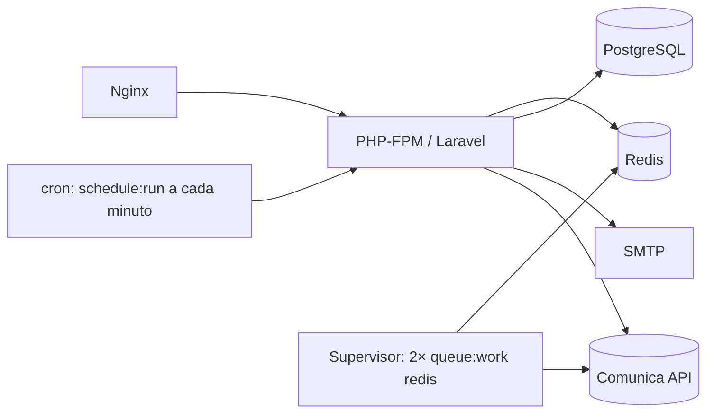

# 10 · Operação e deploy

> [!WARNING]
> **O servidor precisa ter IP no Brasil.** A Comunica API responde `403` para acessos
> de fora do país. Isso vale para o site e para os workers. Use uma região brasileira
> (por exemplo, AWS `sa-east-1`, São Paulo).

> [!TIP]
> Produção em **https://faroljuris.com.br**, publicada pelo **Ploi** num VPS da Hostinger:
> passo a passo em [13 · Deploy no Ploi](13-deploy-ploi.md). As peças abaixo (nginx,
> supervisor, cron, `deploy.sh`) são para um VPS sem painel; no Ploi, cada uma vira uma aba.

## Peças em produção



| Peça        | Arquivo de referência                      | Observação                                                                                             |
| ----------- | ------------------------------------------ | ------------------------------------------------------------------------------------------------------ |
| Nginx       | `deploy/nginx/faroljuris.conf`             | HTTPS com certbot; validado com `nginx -t`                                                             |
| Workers     | `deploy/supervisor/faroljuris-worker.conf` | 2 processos, `--tries=3 --timeout=650 --max-time=3600`                                                 |
| Scheduler   | `deploy/cron/faroljuris`                   | `* * * * * php artisan schedule:run`                                                                   |
| `.env`      | `deploy/env.production.example`            | Valores de produção, sem segredos                                                                      |
| Atualização | `deploy/deploy.sh`                         | manutenção → pull → composer `--no-dev` → build → migrate → `optimize` → `queue:restart` → diagnóstico |

O `--timeout=650` do worker é maior que o `timeout` de 600 s do `GerarExportacaoJob`,
para que uma exportação grande não seja morta no meio.

Passo a passo da primeira instalação: [README › Deploy](../README.md#deploy-em-produção).
Atualizações:

```bash
./deploy/deploy.sh main
```

## Tarefas agendadas

Definidas em `routes/console.php`:

| Quando                                           | Comando                                              | Para quê                                             |
| ------------------------------------------------ | ---------------------------------------------------- | ---------------------------------------------------- |
| `DJEN_MONITORING_TIME` (07:00, `America/Manaus`) | `djen:monitorar`                                     | Enfileira a verificação de cada alvo                 |
| 03:17 todo dia                                   | `model:prune` (comunicações, exportações e rastreio) | LGPD: órfãs, exportações expiradas e rastreio antigo |

O monitoramento usa `withoutOverlapping()` e `onOneServer()`. Com mais de um servidor,
o cache precisa ser compartilhado (Redis).

## Comandos Artisan do projeto

| Comando                                                                                                  | Uso                                                                                                                   |
| -------------------------------------------------------------------------------------------------------- | --------------------------------------------------------------------------------------------------------------------- |
| `php artisan djen:diagnostico [--sem-api]`                                                               | Checklist do ambiente: banco, cache, fila, e-mail, gateway, horário e acesso à API. Mostra o `x-ratelimit-remaining`. |
| `php artisan djen:verificar-filtros --oab= --uf= [--processo= --parte= --advogado= --tribunal= --data=]` | Confere na API real se cada filtro funciona. **Rode após o primeiro deploy.**                                         |
| `php artisan djen:monitorar [--alvo=ID]... [--sync]`                                                     | Monitora agora (fila ou síncrono).                                                                                    |
| `php artisan schedule:test --name=djen:monitorar`                                                        | Dispara a tarefa agendada como o scheduler faria.                                                                     |
| `php artisan usuario:criar email [--nome=] [--admin]`                                                    | Cria uma conta já confirmada (o caminho com o cadastro fechado). Pede a senha sem mostrar.                            |
| `php artisan admin:promover email [--remover]`                                                           | Dá ou tira o acesso à área administrativa (`/admin`).                                                                 |
| `php artisan djen:capturar-fixture [...]`                                                                | Salva uma resposta real como fixture (anonimize antes de commitar).                                                   |

`djen:diagnostico` avisa (em amarelo) sobre configurações que funcionam mas
provavelmente não são o que você quer em produção: fila `sync`, e-mail `log`/`array`,
`DJEN_GATEWAY=fake`.

## Configuração (`config/djen.php`)

| Variável                                          | Padrão                                  | Para quê                                                               |
| ------------------------------------------------- | --------------------------------------- | ---------------------------------------------------------------------- |
| `DJEN_GATEWAY`                                    | `api`                                   | `api` (CNJ) ou `fake` (dados fictícios)                                |
| `DJEN_BASE_URL`                                   | `https://comunicaapi.pje.jus.br/api/v1` | Homologação: `https://hcomunicaapi.cnj.jus.br/api/v1`                  |
| `DJEN_USER_AGENT`                                 | `FarolJuris/1.0`                        | Identificação nas chamadas                                             |
| `DJEN_TIMEOUT` / `DJEN_CONNECT_TIMEOUT`           | 20 / 5 s                                | Timeouts                                                               |
| `DJEN_RETRY_TIMES`                                | 3                                       | Tentativas extras (conexão, 429, 5xx)                                  |
| `DJEN_RETRY_SLEEP_MS` / `DJEN_RETRY_MAX_SLEEP_MS` | 500 / 10000                             | Base e teto do backoff                                                 |
| `DJEN_ITENS_POR_PAGINA`                           | 20                                      | Resultados por página na Consulta                                      |
| `DJEN_CACHE_TTL`                                  | 600 s                                   | Cache das consultas                                                    |
| `DJEN_RATE_LIMIT_PER_MINUTE`                      | 15                                      | Chamadas ao CNJ por minuto (jobs, global)                              |
| `DJEN_PUBLIC_RATE_LIMIT_PER_MINUTE`               | 30                                      | Consultas por minuto, por IP                                           |
| `DJEN_MONITORING_TIME` / `_TIMEZONE`              | `07:00` / `America/Manaus`              | Horário do monitoramento                                               |
| `DJEN_MONITORING_LOOKBACK_DAYS`                   | 3                                       | Janela de cada verificação                                             |
| `DJEN_MONITORING_ITENS_POR_PAGINA`                | 100                                     | Página usada pelo job                                                  |
| `DJEN_MONITORING_MAX_PAGINAS`                     | 5                                       | Páginas por alvo por execução (máx. 500 comunicações)                  |
| `DJEN_MONITORING_MAX_ALVOS`                       | 50                                      | Alvos por usuário                                                      |
| `DJEN_EXPORT_DISK`                                | `local`                                 | Disco privado dos arquivos                                             |
| `DJEN_EXPORT_LIMITE_SINCRONO`                     | 100                                     | Até quantos itens gera na hora                                         |
| `DJEN_EXPORT_MAX_ITENS`                           | 2000                                    | Itens por exportação                                                   |
| `DJEN_EXPORT_DIAS_RETENCAO`                       | 7                                       | Dias até apagar exportações                                            |
| `APP_CADASTRO_ABERTO`                             | `false`                                 | Cadastro pelo site; fechado, as contas são criadas com `usuario:criar` |
| `DJEN_RASTREIO_ATIVO`                             | `true`                                  | Rastreio da área administrativa                                        |
| `DJEN_RASTREIO_DIAS_RETENCAO`                     | 180                                     | Dias até apagar buscas, chamadas e eventos rastreados                  |
| `DJEN_WHATSAPP_DRIVER`                            | `log`                                   | Driver do WhatsApp                                                     |

O app funciona com `php artisan optimize` (config em cache): nenhum `env()` fora de
`config/`. Depois de mudar o `.env` em produção, rode `php artisan optimize` de novo e
`php artisan queue:restart`.

### Dimensionando os limites

Por dia, o monitoramento faz no mínimo uma chamada por alvo ativo (mais se houver mais
de 100 comunicações na janela). Com `DJEN_RATE_LIMIT_PER_MINUTE=15`, 300 alvos levam
uns 20 minutos. A API do CNJ anuncia `x-ratelimit-limit: 20`; subir o nosso limite para
perto disso deixa pouca folga para a Consulta pública.

## Saúde e logs

- **Área administrativa** (`/admin`): uso, buscas, atividade, contas e cada chamada ao CNJ
  (latência, falhas, limite restante). Ver [11 · Administração e rastreio](11-administracao-e-rastreio.md).

- **Health check**: `GET /up`.
- **Logs**: `storage/logs/laravel.log` (erros do CNJ são registrados com `report()`) e
  `storage/logs/worker.log` (workers).
- **Jobs que falharam**: `php artisan queue:failed`; reprocessar com
  `php artisan queue:retry all`.
- **Erros para o usuário**: páginas Inertia `Erro` para 403/404/429/500/503; com
  `APP_DEBUG=true`, o 500 mostra o erro detalhado.

## Solução de problemas

| Sintoma                                                   | Causa provável e o que fazer                                                                            |
| --------------------------------------------------------- | ------------------------------------------------------------------------------------------------------- |
| "O CNJ recusou o acesso a partir deste servidor"          | IP fora do Brasil (`403`). `php artisan djen:diagnostico`.                                              |
| Resultados não batem com o filtro                         | Nome de parâmetro errado. `php artisan djen:verificar-filtros` e ajuste `DjenApiGateway::parametros()`. |
| "Muitas consultas ao CNJ"                                 | `429` da API. Espere; se for frequente, reduza o tráfego ou aumente o `DJEN_CACHE_TTL`.                 |
| E-mail do monitoramento/exportação não chega              | `queue:work` parado, ou `MAIL_MAILER` de teste. Veja `djen:diagnostico`.                                |
| Exportação parada em "Na fila"                            | `queue:work` parado (`supervisorctl status`).                                                           |
| `schedule:test` diz "No matching scheduled command found" | Use `--name=djen:monitorar` (compara com o comando, não com a descrição).                               |
| Monitoramento não rodou no horário                        | Cron ausente, ou fuso diferente do esperado em `DJEN_MONITORING_TIMEZONE`.                              |
| Alerta duplicado                                          | Não deveria acontecer (índices únicos). Verifique se as migrations rodaram.                             |
| Mudança no `.env` sem efeito                              | Config em cache: `php artisan optimize` e `queue:restart`.                                              |
