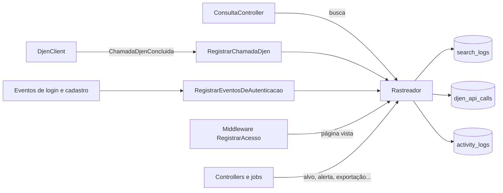

# 11 · Área administrativa e rastreio

Área interna em `/admin`, só para administradores: quantas buscas foram feitas, por quem,
com quais filtros, de onde vêm os visitantes, o que acontece com as contas e como está a
integração com o CNJ.


## Acesso

- Coluna `users.is_admin` (padrão `false`). Não é editável por formulário nenhum.
- Gate `admin` (`AppServiceProvider`) e middleware `can:admin` nas rotas.
- Visitante é mandado para o login; usuário comum recebe a página de erro 403.
- O menu lateral mostra "Administração" quando `auth.user.is_admin` é verdadeiro.

```bash
php artisan admin:promover pessoa@exemplo.com            # concede
php artisan admin:promover pessoa@exemplo.com --remover  # retira
php artisan usuario:criar pessoa@exemplo.com --admin     # cria a conta já como administradora
```

Com o cadastro pelo site fechado (`APP_CADASTRO_ABERTO=false`, o padrão), novas contas só
nascem pelo `usuario:criar`.

No ambiente local, o seeder cria `admin@faroljuris.test` / `password` (não roda em produção).

## Telas

| Rota                   | Nome              | O que mostra                                                                                                                                                                           |
| ---------------------- | ----------------- | -------------------------------------------------------------------------------------------------------------------------------------------------------------------------------------- |
| `GET /admin`           | `admin.dashboard` | Indicadores do período, buscas e visitantes por dia, resultado, critério, horário, termos, tribunais, UFs, dispositivos, navegadores, origem do tráfego, páginas e saúde da API do CNJ |
| `GET /admin/buscas`    | `admin.buscas`    | Cada busca: quando, filtros, resultado, tempo (e se veio do cache), quem (usuário ou visitante pseudonimizado) e dispositivo                                                           |
| `GET /admin/atividade` | `admin.atividade` | Trilha de eventos, com contagem por tipo e filtro por usuário                                                                                                                          |
| `GET /admin/usuarios`  | `admin.usuarios`  | Contas, com alvos, alertas, buscas, exportações e último acesso                                                                                                                        |
| `GET /admin/cnj`       | `admin.cnj`       | Cada requisição real à Comunica API: origem, parâmetros, resultado, latência, itens e limite restante                                                                                  |

Todas aceitam o período na URL (`?periodo=hoje|7d|30d|90d` ou
`?periodo=personalizado&inicio=AAAA-MM-DD&fim=AAAA-MM-DD`, até 366 dias). Os dias são de
calendário no fuso `DJEN_MONITORING_TIMEZONE`. Cada indicador compara com o período anterior
de mesmo tamanho. **Robôs** (User-Agent de bot, `curl` etc.) ficam fora das contagens; nas
listas, "Incluir robôs" os mostra.

## O que é rastreado



| Tabela           | Model           | Uma linha por...                                                        |
| ---------------- | --------------- | ----------------------------------------------------------------------- |
| `search_logs`    | `RegistroBusca` | busca na Consulta (inclusive inválidas e com erro do CNJ)               |
| `djen_api_calls` | `ChamadaDjen`   | requisição HTTP **real** à Comunica API (respostas do cache não contam) |
| `activity_logs`  | `Atividade`     | evento da trilha (tipos em `App\Support\Rastreio\TipoEvento`)           |

### Buscas (`search_logs`)

Gravadas pelo `ConsultaController` sempre que há tentativa de busca:

- `status`: `ok` (com resultados), `vazio`, `erro` (falha do CNJ; `erro_tipo` = `limite`,
  `bloqueado`, `indisponivel` ou `inesperado`) e `invalido` (validação falhou; os campos
  válidos ficam registrados).
- `criterio`: o filtro principal, do mais específico ao mais amplo: processo, OAB, parte,
  advogado, tribunal.
- Filtros (`oab`, `uf`, `parte`, `advogado`, `processo`, `tribunal`, datas, `pagina`),
  `total_resultados`, `duracao_ms` e `do_cache`.
- Abrir a Consulta sem critério não conta como busca (conta só como página vista).

### Chamadas ao CNJ (`djen_api_calls`)

O `DjenClient` dispara o evento `ChamadaDjenConcluida` a cada requisição real. O listener
grava `origem`, `endpoint`, `parametros`, `status`, `resultado` (`sucesso`, `limitado`,
`bloqueado`, `indisponivel`, `recusado`, `invalido`), `duracao_ms` (incluindo as novas
tentativas), `itens` e `ratelimit_restante` (cabeçalho `x-ratelimit-remaining`).

A **origem** vem do `Context` do Laravel: `Rastreador::origem('consulta')` é chamado pela
Consulta, `monitoramento` pelo `MonitorarAlvoJob`, `exportacao` pela exportação e
`comando` pelos comandos `djen:*`. O `Context` acompanha os jobs na fila.

### Trilha de atividade (`activity_logs`)

| Tipo                                                                                                                                    | Onde é gravado                                                    |
| --------------------------------------------------------------------------------------------------------------------------------------- | ----------------------------------------------------------------- |
| `pagina.vista`                                                                                                                          | middleware `RegistrarAcesso`                                      |
| `usuario.cadastrado`, `usuario.login`, `usuario.login_falhou`, `usuario.logout`, `usuario.email_verificado`, `usuario.senha_redefinida` | listener `RegistrarEventosDeAutenticacao` (eventos do Laravel)    |
| `conta.excluida`                                                                                                                        | `Settings\ProfileController::destroy`                             |
| `alvo.criado`, `alvo.pausado`, `alvo.retomado`, `alvo.excluido`, `alvo.verificacao_manual`                                              | `AlvoController`                                                  |
| `monitoramento.executado`, `monitoramento.falhou`, `notificacao.enviada`                                                                | `MonitorarAlvoJob`                                                |
| `alerta.lido`, `alerta.nao_lido`, `alertas.todos_lidos`                                                                                 | `AlertaController`                                                |
| `notificacoes.atualizadas`, `dados.excluidos`                                                                                           | `PreferenciasController`                                          |
| `exportacao.criada`, `exportacao.concluida`, `exportacao.falhou`, `exportacao.baixada`, `exportacao.excluida`                           | `ExportacaoController`, `GeradorExportacao`, `GerarExportacaoJob` |
| `admin.promovido`, `admin.removido`                                                                                                     | comando `admin:promover`                                          |

`dados` (jsonb) guarda só identificadores e números: `alvo_id`, `exportacao_id`, `formato`,
`quantidade`, `duracao_ms`... Nunca o valor de um alvo nem o e-mail digitado num login que
falhou (só `conta_existe`).

A página vista **não** é registrada para: requisições que não são `GET`, respostas que não
são página (JSON, download, redirecionamento), recargas parciais do Inertia (polling,
props preguiçosas), prefetch e a própria área `/admin`. O caminho é gravado **sem a query
string**, que pode conter dados de busca.

### Origem de cada requisição

`App\Support\Rastreio\Origem` (buscas e eventos com requisição):

| Campo                                        | Conteúdo                                                                                                |
| -------------------------------------------- | ------------------------------------------------------------------------------------------------------- |
| `visitante`                                  | HMAC-SHA256 de IP + User-Agent com a `APP_KEY`, 16 caracteres. Conta visitantes únicos sem guardar o IP |
| `ip_mascarado`                               | IPv4 com o último octeto zerado (`177.12.34.0`); IPv6 só com o prefixo /48                              |
| `dispositivo`, `navegador`, `sistema`, `bot` | lidos do User-Agent por `App\Support\Rastreio\Agente` (sem biblioteca externa)                          |
| `referer_host`                               | só o domínio de origem do link, e só se for outro site                                                  |

Eventos gerados em jobs e comandos não têm origem (aparecem como "Fila / agendador").

## Garantias

- **O rastreio nunca derruba a aplicação**: qualquer falha ao gravar é só reportada
  (`Rastreador::gravar`). Há teste que apaga a tabela e confere que a Consulta continua
  respondendo.
- **Desligável**: `DJEN_RASTREIO_ATIVO=false`.
- Nos testes `Unit` o rastreio fica desligado (eles não limpam o banco). Ele é testado em
  `tests/Feature/Rastreio` e `tests/Feature/Admin`.

## LGPD

- **Minimização**: IP mascarado, visitante pseudonimizado, sem query string, sem e-mail
  digitado em login que falhou, sem valor de alvo nos eventos.
- **Retenção**: `DJEN_RASTREIO_DIAS_RETENCAO` (180 dias). O `model:prune` diário (03:17)
  apaga buscas, chamadas e eventos mais antigos.
- **Exclusão da conta**: as linhas ficam com `user_id` nulo (FK `nullOnDelete`) e somem
  na retenção. As buscas feitas pela pessoa continuam associadas ao identificador
  pseudonimizado do visitante até lá.
- **Termos buscados** (nomes de partes e advogados) ficam gravados, porque mostrar o que se
  busca é o propósito do relatório. São dados que o DJEN publica, mas continuam sendo dados
  pessoais: o acesso é restrito aos administradores e expira com a retenção. Se isso não for
  desejado, reduza a retenção ou desligue o rastreio.
- Recomenda-se citar o rastreio na política de privacidade do site.

## Como as métricas são calculadas

`App\Services\Admin\MetricasAdmin`, tudo em SQL no PostgreSQL:

- Dia e hora locais: `(created_at AT TIME ZONE 'UTC') AT TIME ZONE '<fuso>'` (os timestamps
  são gravados em UTC).
- **Visitantes únicos**: `UNION` dos `visitante` de buscas e de páginas vistas.
- **Usuários ativos**: `UNION` dos `user_id` de atividade e de buscas.
- **Buscas com resultado** e **respondidas pelo cache**: percentuais sobre as buscas
  respondidas (`ok` + `vazio`).
- **Latência p95**: `percentile_cont(0.95)` sobre `duracao_ms`.
- **Termos mais buscados**: top 10 por tipo, com nomes em maiúsculas para juntar grafias.

## Gráficos

Feitos à mão em SVG (`resources/js/components/admin/`), sem biblioteca de gráficos:

| Componente        | Uso                                                                              |
| ----------------- | -------------------------------------------------------------------------------- |
| `GraficoColunas`  | séries por dia e por hora; tooltip com mouse **e** teclado (setas)               |
| `ListaBarras`     | rankings, com rótulo, valor e percentual escritos                                |
| `BarraSegmentada` | partes de um todo (resultado das buscas, das chamadas ao CNJ) com ícone e rótulo |
| `CartaoIndicador` | número em destaque e variação contra o período anterior                          |
| `CartaoGrafico`   | moldura com o botão **Tabela**, que mostra os mesmos números em texto            |

Uma cor só para as séries (`--viz-serie`) e cores de estado (`--viz-bom`, `--viz-alerta`,
`--viz-critico`, `--viz-neutro`) que nunca aparecem sozinhas: sempre com ícone e rótulo.
As cores foram validadas (contraste e daltonismo) para o tema claro e o escuro; estão em
`resources/css/app.css`.

## Estendendo

- **Novo tipo de evento**: constante e rótulo em `TipoEvento`, e uma chamada
  `$rastreador->evento(TipoEvento::X, [...], $user, $request)` onde ele acontece.
- **Novo indicador**: método em `MetricasAdmin`, a chave no tipo `DashboardProps`
  (`resources/js/types/admin.ts`) e um `CartaoIndicador` na `Admin/Dashboard.vue`.
- Volume alto: as tabelas têm índice em `created_at` e nos filtros mais usados. Se o
  tráfego crescer muito, considere gravar o rastreio pela fila ou agregar por dia.
