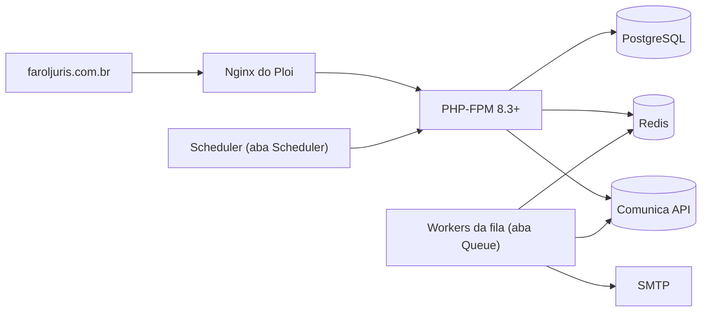

# 13 · Deploy no Ploi (VPS Hostinger)

Produção: **https://faroljuris.com.br** (com `www.faroljuris.com.br` redirecionando para ele),
num VPS da Hostinger gerenciado pelo [Ploi](https://ploi.io), dividindo o servidor com
outros sites.

> [!WARNING]
> **O VPS precisa ter IP no Brasil.** A Comunica API do CNJ responde `403` para acessos de
> fora do país. Confira antes de tudo (passo 1).



## 1. Conferir o servidor (SSH)

O servidor alcança a API do CNJ?

```bash
curl -s -o /dev/null -w "%{http_code}\n" "https://comunicaapi.pje.jus.br/api/v1/comunicacao?itensPorPagina=1"
```

`200` = ok. `403` = VPS fora do Brasil: troque para o data center de São Paulo no hPanel
da Hostinger antes de continuar.

Recursos e versões:

```bash
free -h && php -v && node -v && psql --version
```

| Requisito | Mínimo                                                                                            |
| --------- | ------------------------------------------------------------------------------------------------- |
| PHP       | 8.3, com `pdo_pgsql`, `redis`, `mbstring`, `xml`, `zip`, `gd`, `intl`                             |
| Node      | 22 (só para o build)                                                                              |
| Banco     | PostgreSQL (o app usa `jsonb`, `ILIKE`, `AT TIME ZONE`, `percentile_cont`; **não roda em MySQL**) |
| Redis     | cache, sessão e fila                                                                              |
| Memória   | 2 GB funciona; 4 GB recomendado com outros sites no mesmo VPS                                     |

## 2. PostgreSQL

Se o servidor foi criado no Ploi com MySQL, instale o PostgreSQL ao lado (convivem sem
problema). Troque `8.3` pela versão de PHP do site:

```bash
sudo apt update && sudo apt install -y postgresql php8.3-pgsql
```

```bash
sudo -u postgres psql -c "CREATE USER faroljuris WITH PASSWORD 'troque-por-uma-senha-forte';"
```

```bash
sudo -u postgres createdb -O faroljuris faroljuris
```

```bash
sudo systemctl restart php8.3-fpm
```

Redis (o Ploi costuma instalar): `redis-cli ping` deve responder `PONG`.

## 3. DNS

No Registro.br (ou onde o domínio estiver):

| Tipo | Nome  | Valor     |
| ---- | ----- | --------- |
| A    | `@`   | IP do VPS |
| A    | `www` | IP do VPS |

Confira a propagação antes de gerar o SSL:

```bash
dig +short faroljuris.com.br
```

```bash
dig +short www.faroljuris.com.br
```

## 4. Site no Ploi

1. **Server → Sites → Add site**: domínio `faroljuris.com.br`, diretório web `/public`,
   projeto **Laravel**.
2. Alias `www.faroljuris.com.br`, com redirecionamento do `www` para o domínio sem `www`.
3. **Repository**: GitHub, `samuelsonbrito/FarolJuris`, branch `main`.
4. **PHP version**: 8.3 ou mais.

## 5. Ambiente (aba Environment)

Parta do `.env.example` e aplique (também em `deploy/env.production.example`):

```dotenv
APP_NAME=FarolJuris
APP_ENV=production
APP_DEBUG=false
APP_URL=https://faroljuris.com.br
LOG_LEVEL=warning
LOG_STACK=daily

DB_CONNECTION=pgsql
DB_HOST=127.0.0.1
DB_PORT=5432
DB_DATABASE=faroljuris
DB_USERNAME=faroljuris
DB_PASSWORD=senha-do-passo-2

REDIS_HOST=127.0.0.1
SESSION_DRIVER=redis
SESSION_SECURE_COOKIE=true
SESSION_ENCRYPT=true
CACHE_STORE=redis
QUEUE_CONNECTION=redis

MAIL_MAILER=smtp
MAIL_HOST=smtp.seu-provedor.com
MAIL_PORT=587
MAIL_USERNAME=...
MAIL_PASSWORD=...
MAIL_FROM_ADDRESS="alertas@faroljuris.com.br"
MAIL_FROM_NAME="${APP_NAME}"

DJEN_GATEWAY=api
DJEN_BASE_URL=https://comunicaapi.pje.jus.br/api/v1
DJEN_MONITORING_TIME=07:00
DJEN_MONITORING_TIMEZONE=America/Manaus
```

- **E-mail**: sem SMTP ninguém confirma o cadastro e os alertas não saem. Pode ser o e-mail
  da Hostinger (em geral `smtp.hostinger.com`, porta 465, `MAIL_SCHEME=smtps`; confira no
  hPanel) ou um serviço transacional (Resend, Brevo, Amazon SES). Configure **SPF** e
  **DKIM** (e, se possível, **DMARC**) no DNS de `faroljuris.com.br`, senão os alertas caem
  no spam.
- Sem `APP_KEY`? Gere uma vez, por SSH, na pasta do site: `php artisan key:generate --force`.
- Mudou o `.env` depois do deploy? Rode `php artisan optimize` e `php artisan queue:restart`.

## 6. Script de deploy (aba Deploy script)

Copie o conteúdo de [`deploy/ploi/deploy-script.sh`](../deploy/ploi/deploy-script.sh). Ele
mantém as variáveis do Ploi (`{SITE_DIRECTORY}`, `{BRANCH}`, `{RELOAD_PHP_FPM}`) e roda:
`git pull` → `composer install --no-dev` → `npm ci && npm run build` → `migrate --force` →
`optimize` → `queue:restart`.

O build precisa do PHP (gera as rotas do front), por isso roda no servidor. Depois,
**Deploy now**. Opcional: deploy automático a cada push na `main`.

## 7. SSL (aba SSL)

Let's Encrypt para `faroljuris.com.br` **e** `www.faroljuris.com.br`, depois que o DNS
propagar.

## 8. Fila (aba Queue → Add worker)

| Campo      | Valor     |
| ---------- | --------- |
| Connection | `redis`   |
| Queue      | `default` |
| Processes  | `2`       |
| Tries      | `3`       |
| Timeout    | `650`     |
| Sleep      | `3`       |

O `Timeout` fica acima dos 600 s do `GerarExportacaoJob`. Sem worker não há e-mails,
monitoramento nem exportações grandes.

## 9. Agendador (aba Scheduler)

Ative o **Laravel scheduler** (`schedule:run` a cada minuto): monitoramento diário e limpeza
LGPD (`model:prune` às 03:17).

## 10. Primeiro acesso

1. O cadastro pelo site fica **fechado** (`APP_CADASTRO_ABERTO=false`). Crie a sua conta,
   já confirmada e com acesso à área administrativa (SSH ou aba **Commands**, na pasta do
   site; a senha é pedida sem aparecer na tela):

```bash
php artisan usuario:criar seu@email.com --nome="Seu Nome" --admin
```

2. Para dar acesso administrativo a uma conta que já existe:

```bash
php artisan admin:promover seu@email.com
```

3. Diagnóstico (tudo "OK", inclusive a API do CNJ):

```bash
php artisan djen:diagnostico
```

4. Conferir na API real os nomes dos filtros (ainda não validados; ver
   [03 · Integração](03-integracao-djen.md#parâmetros-de-filtro)):

```bash
php artisan djen:verificar-filtros --oab=SUA_OAB --uf=UF --processo=UM_PROCESSO --parte="UM NOME"
```

Algum **FALHOU**? Ajuste o nome em `DjenApiGateway::parametros()` (branch `fix/...`).

## Equivalência com o VPS sem painel

| Arquivo em `deploy/`                | No Ploi                  |
| ----------------------------------- | ------------------------ |
| `nginx/faroljuris.conf`             | gerado pelo Ploi no site |
| `supervisor/faroljuris-worker.conf` | aba **Queue**            |
| `cron/faroljuris`                   | aba **Scheduler**        |
| `deploy.sh`                         | aba **Deploy script**    |
| `env.production.example`            | aba **Environment**      |

## Problemas comuns

| Sintoma                                          | Causa                                                          |
| ------------------------------------------------ | -------------------------------------------------------------- |
| "O CNJ recusou o acesso a partir deste servidor" | VPS fora do Brasil (passo 1)                                   |
| E-mails não chegam / caem no spam                | SMTP errado, worker parado ou falta de SPF/DKIM (passos 5 e 8) |
| Mudança no `.env` sem efeito                     | Config em cache: `php artisan optimize` e `queue:restart`      |
| SSL não emite                                    | DNS ainda não propagou (passo 3)                               |
| Erro 500 após o deploy                           | `storage/logs/laravel-AAAA-MM-DD.log`                          |
| `could not find driver` (pgsql)                  | Falta `php8.X-pgsql` na versão de PHP do site (passo 2)        |
