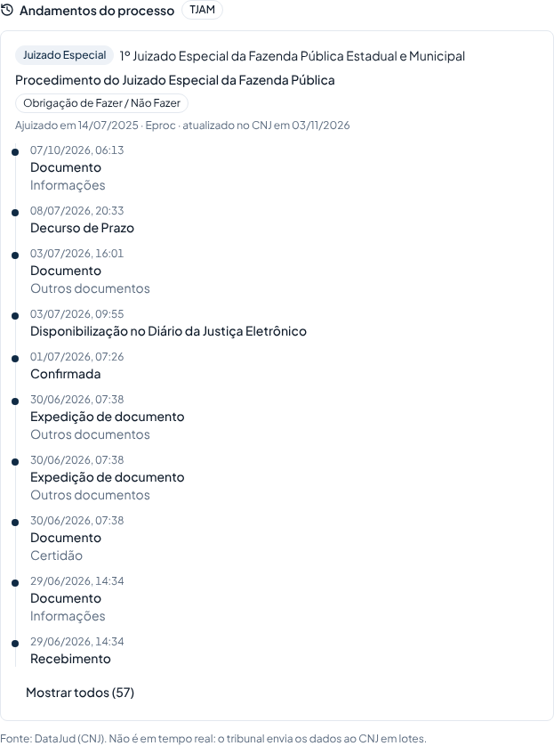

# 14 · Andamentos do processo (DataJud)

No painel lateral da comunicação, os processos de tribunais habilitados ganham a seção
**Andamentos do processo**: classe, assuntos, órgão, data de ajuizamento e a linha do tempo de
todos os movimentos registrados pelo tribunal. Começamos pelo **TJAM**.



## De onde vem

[API Pública do DataJud](https://www.cnj.jus.br/sistemas/datajud/api-publica/), do CNJ. É
diferente da Comunica API (DJEN): o DJEN traz as **publicações**; o DataJud, os **metadados e
movimentos** do processo.

```bash
curl -X POST "https://api-publica.datajud.cnj.jus.br/api_publica_tjam/_search" \
  -H "Authorization: APIKey <chave pública>" \
  -H "Content-Type: application/json" \
  -d '{"size": 10, "query": {"match": {"numeroProcesso": "01234567820268041000"}}}'
```

- Um índice por tribunal (`api_publica_tjam`, `api_publica_tjsp`...).
- A chave é pública, divulgada em https://datajud-wiki.cnj.jus.br/api-publica/acesso. O CNJ pode
  trocá-la: atualize `DATAJUD_API_KEY`.
- Resposta (Elasticsearch): `hits.hits[]._source` com `tribunal, grau, numeroProcesso,
  dataAjuizamento (YmdHis), nivelSigilo, orgaoJulgador{codigo, nome}, classe{codigo, nome},
  sistema, formato, dataHoraUltimaAtualizacao, assuntos[{codigo, nome}], movimentos[{codigo,
  nome, dataHora, complementosTabelados[{codigo, descricao, valor, nome}], orgaoJulgador}]`.
  Fixtures reais em `tests/Fixtures/datajud/`.
- O mesmo número pode ter um registro por grau (`G1`, `G2`, `JE`...): o painel mostra todos.

## Limitações

- **Não traz partes nem advogados**, nem processos em **segredo de justiça**.
- **Não é em tempo real**: o tribunal envia os dados ao CNJ em lotes (o painel mostra
  "atualizado no CNJ em").
- **Lenta e instável**: respostas de 15 a 50 s e, às vezes, 429 (sobrecarga,
  `es_rejected_execution_exception`). Por isso a consulta é **sob demanda** (botão "Ver
  andamentos"), com cache de 6 h e limite por IP.

## Como funciona no app

```mermaid
flowchart LR
    P[PainelComunicacao] -->|tribunal em datajudTribunais| A[AndamentosProcesso]
    A -->|clique: GET /processos/{numero}/andamentos?tribunal=TJAM| C[AndamentosController]
    C --> D[DatajudClient] -->|cache 6 h| API[(DataJud / CNJ)]
```

| Peça                                                     | O que faz                                                                                                                                        |
| -------------------------------------------------------- | ------------------------------------------------------------------------------------------------------------------------------------------------ |
| `config/datajud.php`                                     | URL, chave, timeout (55 s), cache (6 h), limite por IP (10/min) e `tribunais` (sigla → índice)                                                   |
| `App\Services\Datajud\DatajudClient`                     | único ponto de contato; `POST _search`, confere o número exato, cache (inclusive "não encontrado"), `DatajudException` (com `sobrecarga` no 429) |
| `App\Data\Datajud\ProcessoDatajudData` / `MovimentoData` | DTOs; movimentos do mais recente para o mais antigo                                                                                              |
| `Datajud\AndamentosController`                           | rota pública `processos.andamentos` (`throttle:datajud`); JSON `{data}` ou `{erro}` (404 tribunal não habilitado, 503 falha)                     |
| `ProcessoDatajudResource`                                | JSON espelhado em `resources/js/types/datajud.ts` (com `grauRotulo`)                                                                             |
| prop compartilhada `datajudTribunais`                    | quais tribunais mostram a seção no painel                                                                                                        |
| `components/AndamentosProcesso.vue`                      | botão, carregamento, erro com "tentar de novo", vazio, 10 movimentos + "mostrar todos"                                                           |

## Configuração

| Variável                        | Padrão                                                   |
| ------------------------------- | -------------------------------------------------------- |
| `DATAJUD_ATIVO`                 | `true` (`false` esconde a seção)                         |
| `DATAJUD_API_KEY`               | a chave pública atual do CNJ                             |
| `DATAJUD_TIMEOUT`               | `55` (o nginx do deploy tem `fastcgi_read_timeout 120s`) |
| `DATAJUD_CACHE_TTL`             | `21600` (6 h)                                            |
| `DATAJUD_RATE_LIMIT_POR_MINUTO` | `10` por IP                                              |

## Outro tribunal

Acrescente a sigla e o índice em `config/datajud.php` (`'TJSP' => 'api_publica_tjsp'`). A lista de
índices está na wiki do DataJud (Endpoints).
