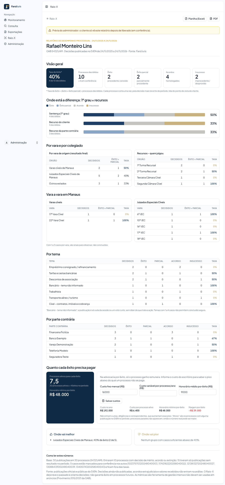
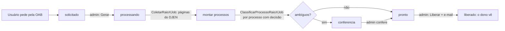

# 15 · Raio-X de desempenho

Menu **Raio-X** (usuários logados): a partir da OAB, reúne as decisões publicadas no DJEN nos
últimos 12 meses, classifica cada uma do ponto de vista do cliente com IA (Claude) e mostra a taxa de
êxito por instância, vara, colegiado, tema e parte contrária, além do custo de cada êxito.

## Fluxo

| Status        | Significado                                                                                   |
| ------------- | --------------------------------------------------------------------------------------------- |
| `solicitado`  | Pedido feito; os admins recebem e-mail (`RaioXSolicitado`). Confira se a OAB é de quem pediu. |
| `processando` | Coleta e classificação na fila (a tela do admin atualiza sozinha).                            |
| `conferencia` | Há casos ambíguos (confiança baixa, lado do cliente indefinido ou falha da IA).               |
| `pronto`      | Tudo classificado; falta liberar.                                                             |
| `liberado`    | O dono vê o relatório e recebe e-mail (`RaioXLiberado`).                                      |
| `falhou`      | O DJEN não respondeu na coleta (mensagem em `erro`).                                          |

O admin também pode criar um Raio-X para qualquer conta (pelo e-mail) e vê o relatório antes de
liberar (com aviso de prévia). Gerar de novo apaga a coleta e a classificação anteriores.

## Coleta e classificação

- **Coleta** (`GeradorRaioX::coletar`): `FiltroConsulta(numeroOab, ufOab, dataInicio, dataFim)` paginado de
  100 em 100 (até `RAIOX_MAX_PAGINAS`), com pausa de ~3 s entre páginas (limite de 20/min da Comunica API).
  `ColetarRaioXJob` coleta 15 páginas por tarefa e se reencadeia: cada tarefa fica abaixo do `retry_after`
  (90 s) da fila. As publicações vão para `raiox_publicacoes` (texto puro, destinatários e advogados).
- **Montagem**: um `raiox_processos` por número. Só os processos com publicação "com cara de decisão"
  (`DetectorDecisao`: sentença, acórdão, procedente, provimento, acordo homologado, extinção...) vão para a
  IA; os outros ficam `sem_decisao` (ativos sem decisão no período, sem custo).
- **Classificação** (`ClassificadorIA`): uma chamada por processo, num lote (`Bus::batch`), com as 6
  publicações mais relevantes. Prompt fixo em `ClassificadorIA::SISTEMA` (com cache) e **saída estruturada**
  (JSON Schema estrito): `resultado` (êxito, êxito parcial, acordo, insucesso, sem decisão),
  `extincao_sem_merito`, `instancia` (sentença, recurso do cliente, recurso da parte contrária, outra),
  `orgao_julgador`, `vara_origem`, `grupo_origem`, `tema` (lista fixa do modelo de relatório),
  `parte_contraria` (normalizada: "Bradesco"), `polo_cliente`, `data_decisao`, `hash_decisao`, `confianca` e
  `justificativa`.
- **Conferência**: vão para a fila do admin os casos com `confianca` baixa, polo do cliente indefinido numa
  decisão, recusa da IA, resposta inválida ou erro da API. Até serem conferidos, ficam fora das taxas.

## Métricas (`MetricasRaioX`)

- Cada processo conta uma vez, pela decisão mais recente do período, lida do lado do cliente.
- **Taxa de êxito** = (êxito + êxito parcial) ÷ decididos. Decididos não incluem `sem_decisao` nem os em conferência.
- Por instância (barras), por grupo de origem (rótulos com a capital da UF: "Varas cíveis de Manaus"),
  colegiados que julgaram recursos (cauda em "Outros colegiados"), vara a vara na capital, por tema, por
  parte contrária (cauda em "Demais partes contrárias").
- **Custo**: ativos = processos com publicação no período; custo total = custo fixo mensal × 12 + custo
  variável × ativos; custo por processo = total ÷ ativos; honorário mínimo = total ÷ êxitos; margem =
  honorário médio − mínimo. Os custos são informados pelo advogado na calculadora (tela e PDF).
- **Onde vai melhor/pior**: grupos com pelo menos `RAIOX_MINIMO_DESTAQUE` (5) decididos, acima ou abaixo de 40%.

## Entregas

| Entrega     | Onde                                                                                                                                                                       |
| ----------- | -------------------------------------------------------------------------------------------------------------------------------------------------------------------------- |
| Dashboard   | `RaioX/Show.vue` (`raiox.show`)                                                                                                                                            |
| Calculadora | `components/raiox/CalculadoraCusto.vue` (`PUT raiox.custo`)                                                                                                                |
| Planilha    | `raiox.planilha` → `PlanilhaRaioX` (abas: Processos, Instância, Por vara de origem, Por vara na capital, Por colegiado, Por tema, Por parte contrária, Custo por processo) |
| PDF         | `raiox.pdf` → `resources/views/exports/raiox.blade.php` (dompdf)                                                                                                           |
| Admin       | `Admin/RaioX/Index.vue` (pedidos, gerar, liberar) e `Admin/RaioX/Conferencia.vue`                                                                                          |

## Configuração (`config/raiox.php`)

| Variável            | Padrão            |                                                                         |
| ------------------- | ----------------- | ----------------------------------------------------------------------- |
| `ANTHROPIC_API_KEY` | —                 | **obrigatória em produção** (chave da API da Anthropic)                 |
| `RAIOX_IA_DRIVER`   | `claude`          | `fake` usa regras e dados de exemplo, sem IA (desenvolvimento e testes) |
| `RAIOX_IA_MODELO`   | `claude-opus-5-5` | modelo da classificação                                                 |
| `RAIOX_IA_ESFORCO`  | `low`             | esforço (`output_config.effort`)                                        |
| `RAIOX_MESES`       | `12`              | período analisado                                                       |
| `RAIOX_MAX_PAGINAS` | `60`              | teto de páginas de 100 publicações                                      |
| `RAIOX_PAUSA_MS`    | `3100`            | pausa entre páginas do DJEN                                             |

O admin vê o modelo e os tokens gastos em cada Raio-X. A ordem de grandeza: algumas dezenas a poucas
centenas de chamadas por OAB (só processos com decisão), cada uma com poucos milhares de tokens.

## LGPD e regras da OAB

- Publicações, processos e classificações ficam em `raiox_*` e somem com o relatório e com a conta
  (FK em cascata). O relatório só aparece para o dono depois de liberado.
- O texto das decisões vai para a API da Anthropic para classificação.
- Os números são ferramenta de gestão interna; taxas de êxito não devem ser usadas em anúncios
  (Provimento 205/2021). O relatório diz isso no fim.
